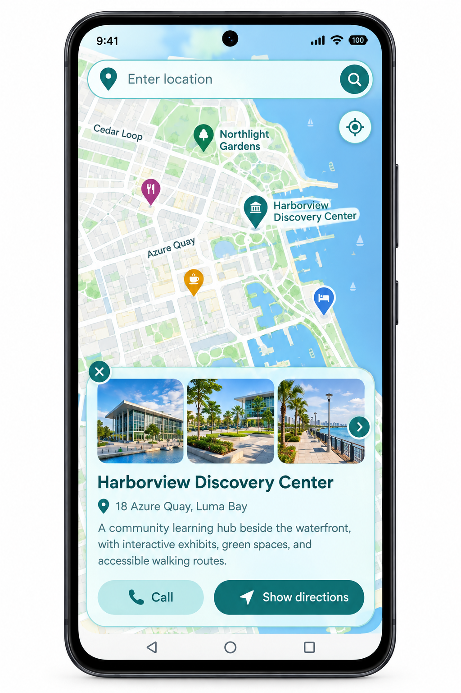

# Harborview Explorer
<p align="center">
  
</p>

## Overview

Harborview Explorer is a responsive web mapping application designed to make exploring locations simple and intuitive. It combines an interactive map with a clean, mobile-friendly interface to demonstrate practical Web GIS features.

The project uses Leaflet for map interaction and OpenStreetMap for the basemap. It includes fictional sample locations to demonstrate how geographic features can be displayed, selected, searched, and explored.

## Key Features

- **Interactive Map:** Pan and zoom around the map using Leaflet.
- **Location Search:** Search for place names or enter latitude and longitude coordinates.
- **Custom Map Markers:** Display different point-of-interest categories with custom markers.
- **Category Filters:** Explore sample parks, cultural places, and cafés.
- **Location Details:** Select a marker to view its name, category, address, and description.
- **Current Location:** Use browser geolocation with the user's permission.
- **Directions:** Open the selected coordinates in OpenStreetMap directions.
- **Responsive Design:** A mobile-first interface that also works on desktop screens.

## Technologies Used

- HTML5
- CSS3
- JavaScript
- Leaflet.js
- OpenStreetMap

## Project Structure

```text
harborview-gis-map-app/
├── index.html
├── README.md
├── css/
│   └── style.css
├── js/
│   └── app.js
└── assets/
    ├── favicon.svg
    └── mobile-mockup-preview.png
```

## Getting Started

1. Clone or download this repository.
2. Open `index.html` in a modern browser, or run a local server for the best experience.
3. Explore the map, test the search field, select markers, and try the category filters.

To start a local server with Python:

```bash
python -m http.server 8000
```

Then open `http://localhost:8000` in your browser.

## Live Demo

Add your deployed Vercel or GitHub Pages URL here after publishing the project.

## Data and Attribution

The named points of interest included in this project are fictional demonstration data. The background basemap is provided by OpenStreetMap.

Map data © OpenStreetMap contributors. See https://www.openstreetmap.org/copyright.

Place-name search uses the public OpenStreetMap Nominatim service and is subject to its usage policy: https://operations.osmfoundation.org/policies/nominatim/.

## Purpose

This project demonstrates front-end Web GIS concepts, interactive mapping, location-based interfaces, and responsive web design. It can serve as a foundation for future projects involving real GIS datasets and web mapping services.
